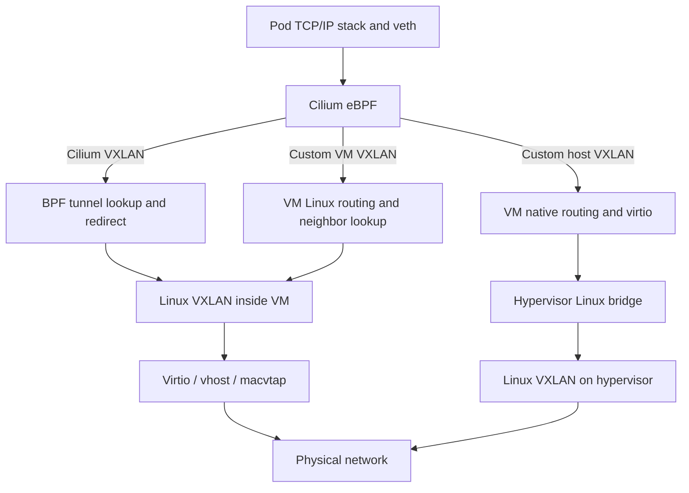

# VXLAN packet paths and bypass options

Reference recorded November 24, 2026. This describes the project's current
Cilium 1.20.4 configuration and possible additional experiments. A subsequent
[isolated TC/eBPF forwarding prototype](vxlan-latency-and-optimization.md) now
exists; it retains Linux VXLAN and has no Cilium integration. The XDP, DPDK and
production hypervisor bridge replacements discussed below remain proposals.

## Main conclusion

Cilium VXLAN and both custom VXLAN implementations currently use Linux VXLAN.
Their main differences are the forwarding decisions before the tunnel, the
surrounding network stack, and whether encapsulation runs inside a VM or on
its physical hypervisor. Cilium's eBPF datapath is not a userspace tunnel engine.

For a small additional experiment, start with a hypervisor TC/eBPF forwarding
path that retains Linux VXLAN. It can test the cost of ordinary bridge/routing
processing with fewer infrastructure changes than DPDK. Treat XDP encapsulation
and a DPDK-based hypervisor switch as separate, larger experiments.

## Current packet paths

These diagrams describe outgoing remote Pod traffic. Application TCP/IP
processing remains inside the guest in all existing modes.



### Cilium VXLAN

Cilium's interface-attached eBPF programs look up remote endpoints, supply
tunnel metadata, and redirect traffic toward `cilium_vxlan`. The Linux tunnel
implementation transmits the encapsulated packet. On reception, Linux
VXLAN decapsulation and Cilium's overlay/endpoint programs cooperate to deliver
the inner packet and apply policy.

The saved interface snapshot identifies `cilium_vxlan` as a Linux VXLAN device
with `external: true`, learning disabled, and UDP port 8472. External/metadata
mode allows tunnel information to be supplied per packet. Cilium's pinned
[encapsulation source](https://github.com/cilium/cilium/blob/v1.20.4/bpf/lib/encap.h)
shows its encapsulation-and-redirect path. Its
[packet-context definitions](https://github.com/cilium/cilium/blob/v1.20.4/bpf/include/bpf/ctx/skb.h)
map tunnel operations to skb helpers.

Cilium also carries source security-identity metadata through its overlay,
which can avoid a receiver-side identity lookup.
[Cilium routing documentation](https://docs.cilium.io/en/stable/network/concepts/routing/)

### Custom VXLAN inside each VM

Cilium runs native routing. Linux routes remote PodCIDRs through `cs740vx`,
using static neighbors and VXLAN forwarding entries installed by our scripts.
The guest's Linux VXLAN device encapsulates the packet before virtio/vhost and
macvtap carry it toward the physical NIC.

The tunnel configuration is in
[`vm-vxlan.sh.j2`](../infrastructure/ansible/roles/custom_vxlan/templates/vm-vxlan.sh.j2).
Cilium still handles Pod networking/policy; our custom tunnel does not itself
implement Cilium's identity-aware overlay control plane.

### Shared VXLAN on each hypervisor

The guest routes Pod traffic natively toward the destination VM. Its experiment
NIC connects to a Linux bridge, `cs740br`, on the physical host. That bridge
forwards cross-host traffic through Linux VXLAN device `cs740hvx`.

The tunnel configuration is in
[`host-vxlan.sh.j2`](../infrastructure/ansible/templates/host-vxlan.sh.j2).
This shifts tunnel work to the hypervisor and shares it across VMs. It also
changes NIC attachment and bridge processing. All cross-host experiment traffic
uses this overlay, including host-network traffic that would bypass the
Pod tunnel in the guest-based modes.

### Netfilter and Service handling

The current baseline retains kube-proxy and does not explicitly enable BPF
masquerading or the optimized BPF host-routing profile. It should not be
described as globally eliminating netfilter. Conversely, the presence of
kube-proxy does not establish that a particular direct Pod-IP benchmark uses
Service load balancing or traverses every iptables hook.

Cilium's TC hooks can redirect packets before ordinary protocol processing.
Exact stack traversal depends on the active path and configuration. A complete
performance explanation requires measurements rather than counting configured
rules. [Cilium TC architecture](https://docs.cilium.io/en/stable/reference-guides/bpf/progtypes/)

## Compare implementations at equal packet size

Use `vxlan`, `vm-vxlan-1450`, and `host-vxlan-1450` for Pod MTU 1450 and physical
underlay MTU 1500. Guest transport NICs remain 1500 when the guest itself adds
the VXLAN headers; in the hypervisor variant, the guest NIC and host bridge can
use 1450.

```bash
./experiments/collect.py --modes vxlan vm-vxlan-1450 host-vxlan-1450 \
  --pod-only --background
```

`--pod-only` makes the measured workloads comparable without mixing in
host-network controls that use different tunnel paths. Equal MTU removes the
packet-size difference, but forwarding, identity handling, bridge traversal,
UDP ports, offloads, and CPU placement still differ. These are end-to-end
implementation comparisons, not isolated measurements of VXLAN header writing.
See [the matched comparison guide](experiments/matched-vxlan.md).

## Proposed TC/eBPF prototype

The initial scope should be two physical hosts, a fixed set of VMs, IPv4,
static endpoint maps, and the existing 1450-byte inner MTU. Put the custom
programs on hypervisor interfaces so they do not replace Cilium's guest hooks.

A candidate path would:

1. Classify the selected experiment traffic arriving from a VM interface.
2. Look up the remote tunnel endpoint in a BPF map.
3. Set tunnel metadata with `bpf_skb_set_tunnel_key()` and redirect into an
   external-mode Linux VXLAN device.
4. On the receive side, redirect decapsulated frames toward the destination VM.

The Linux kernel provides
[tunnel helpers](https://man7.org/linux/man-pages/man7/bpf-helpers.7.html) and
[tunnel selftests](https://github.com/torvalds/linux/blob/master/tools/testing/selftests/bpf/progs/test_tunnel_kern.c)
that can serve as implementation references.

This is a kernel forwarding shortcut: TC still works on skbs and the Linux
VXLAN driver still encapsulates/decapsulates. It can isolate part of the
ordinary forwarding cost without replacing the VM backend or application TCP
stack.

The prototype needs an explicit plan for ARP, non-test traffic, reverse
forwarding, Cilium policy preservation, and attachment cleanup. A side-by-side
fast path may need a separate device/VNI/port so the ordinary control path
remains usable. Do not assume an external-mode device can replace the current
bridge tunnel without providing its per-packet metadata.

As an engineering estimate, a constrained demonstration could take roughly a
day or two. A reproducible experiment with validation, rollback, and useful
attribution requires additional work; this is not a delivery commitment.

## XDP option

Native XDP runs earlier in receive processing and can redirect frames without
sending them through the ordinary receive stack. A custom VXLAN implementation
would need to handle headers, checksums, packet headroom, MTU, endpoint mapping,
and delivery to the VM interfaces. It would also need verified driver support
for the required receive/transmit and multi-buffer behavior.

Generic XDP and native XDP have different performance implications. An ingress
XDP fast path also does not remove the application's TCP processing or all
virtio/vhost costs. [Kernel redirect documentation](https://docs.kernel.org/bpf/redirect.html)

AF_XDP is another option when userspace packet processing is desired without
immediately moving the whole physical NIC to a traditional DPDK poll-mode
backend. It introduces userspace rings and queue/driver integration, and
zero-copy capability must be verified rather than assumed.
[Kernel AF_XDP documentation](https://docs.kernel.org/networking/af_xdp.html)

## DPDK option

For this project, the shortest established DPDK route is a hypervisor switch
using OVS-DPDK, userspace VXLAN, and vhost-user VM interfaces. OVS documents
[userspace VXLAN between VMs](https://docs.openvswitch.org/en/stable/howto/userspace-tunneling/).
This avoids writing a complete tunnel/switch application from scratch.

A suitable hypervisor backend can preserve ordinary TCP applications and
Cilium inside the guests. The integration changes include:

- Replacing the current experiment NIC backend with vhost-user interfaces.
- Configuring shared guest memory and, for the selected deployment, hugepages.
- Selecting a supported physical NIC driver and its device access model.
- Allocating and recording polling-core resources and queue placement.
- Preserving the existing management NIC/SSH path and implementing rollback.

The current Terraform interface choices do not include vhost-user, so this is
an infrastructure change as well as a packet-processing experiment.
[DPDK vhost example](https://doc.dpdk.org/guides-25.11/sample_app_ug/vhost.html)

A standalone DPDK packet-forwarding demo is much less work than preserving our
Kubernetes measurement semantics. Integrating the latter could take several
days to weeks depending on NIC support and virtualization changes. Count the
reserved polling cores in the comparison; throughput alone would hide a large
part of the resource tradeoff.

Using TAP, AF_PACKET, or a kernel exception path to connect a DPDK application
back to Linux can reintroduce stack traversal and copies. Describe precisely
which segment is bypassed instead of labeling any DPDK-based path full kernel
bypass. [DPDK kernel exception path](https://doc.dpdk.org/guides/howto/virtio_user_as_exception_path.html)

## Recommended experiment sequence

1. Finish the current MTU-matched Cilium/custom VXLAN measurements.
2. Add the limited hypervisor TC/eBPF path while retaining Linux VXLAN.
3. Measure traffic-path changes with the same endpoints, MTU, offloads, and
   stream/sample settings. Preserve policy semantics or document reduced scope.
4. Add a separate optimized Cilium profile if needed; do not silently change
   the existing kube-proxy-retaining baseline.
5. Consider XDP or OVS-DPDK as a separate experimental axis if the remaining
   project time and hardware support justify the infrastructure work.

Retain throughput, latency distributions, guest/hypervisor CPU, packet/drop
counters, and offload/queue state. Existing whole-run CPU snapshots include
setup and multiple test cases; synchronized per-test profiling would be needed
for stronger attribution of individual processing costs.
